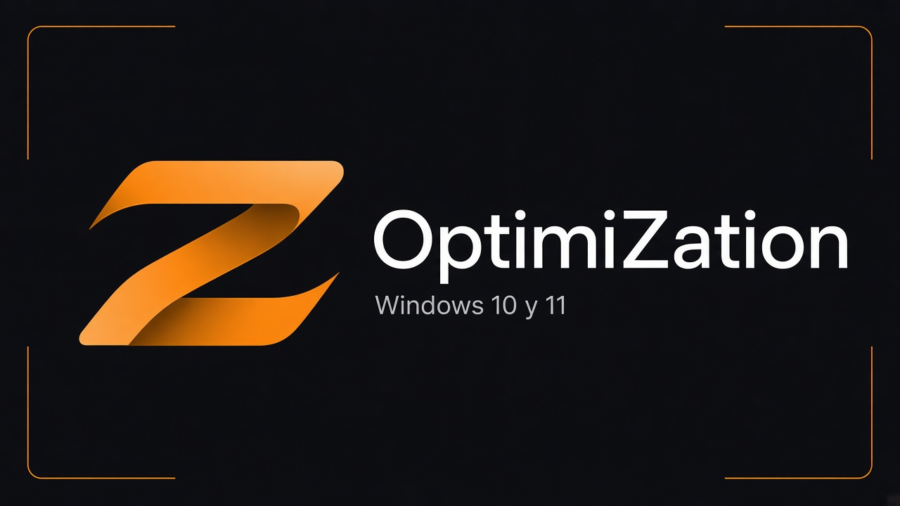

<div align="center">



**OptimiZation** · Versión 2 · by YuzVax

Optimiza Windows 10/11 con perfiles listos o ajustes a medida, sin complicarte.

[Descargar OptimiZation_v2.exe](https://github.com/YuzVax/OptimiZation-App/releases/latest/download/OptimiZation_v2.exe)
·
[Todas las versiones](https://github.com/YuzVax/OptimiZation-App/releases)

</div>

---

## Qué es

OptimiZation es un programa para **Windows** que te ayuda a aplicar mejoras de rendimiento, privacidad y limpieza **con control**: ves qué hace cada cambio, su impacto (Bajo / Medio / Alto) y puedes crear un punto de restauración antes.

Todo en castellano, tema oscuro. Pensado para uso personal; se comparte gratis bajo licencia **no comercial**.

---


## Cómo empezar (lo más fácil)

Solo necesitas el archivo `.exe`. No hace falta instalar Python ni Visual Studio.

### 1. Descarga

1. Entra en [Releases](https://github.com/YuzVax/OptimiZation-App/releases).
2. En la última versión, descarga **`OptimiZation_v2.exe`**.
3. Guárdalo en una carpeta fácil de encontrar (por ejemplo el Escritorio).

### 2. Desbloquear el archivo (si Windows lo marca)

1. Clic derecho en `OptimiZation_v2.exe` → **Propiedades**.
2. Si ves la casilla **Desbloquear**, márcala → **Aplicar** → **Aceptar**.

### 3. Abrir con permisos de administrador

1. Clic derecho en el archivo → **Ejecutar como administrador**.
2. Cuando Windows pregunte, pulsa **Sí**.

> El programa no está firmado digitalmente. Si aparece SmartScreen («Windows protegió tu PC»), pulsa **Más información** y luego **Ejecutar de todas formas** solo si descargaste el archivo desde este repositorio.

### 4. Primeros pasos dentro de la app

1. La **Z** naranja de arriba es la pantalla de inicio.
2. En **Optimizar**, empieza por **Preconfiguradas** si no quieres elegir ajuste a ajuste.
3. Si Windows te pide crear un punto de restauración, acéptalo: es una red de seguridad.
4. Lee el aviso de cada perfil antes de confirmar.

Listo. No hace falta desinstalar nada al cerrar: el EXE limpia los archivos temporales de esa sesión.

---

## Qué puedes hacer

| Sección | Para qué sirve |
|--------|----------------|
| **Optimizar** | Perfiles listos o lista manual de cambios |
| **Acelerar** | Reiniciar Explorer, limpiar temporales, vaciar DNS, limpieza de Windows |
| **Copias** | Crear y usar puntos de restauración |
| **Inicio programas** | Ver y gestionar lo que arranca con Windows |
| **Desinstalador** | Quitar programas (y rastros, con cuidado) |
| **Escáner** | Ver un resumen del equipo (solo lectura) |
| **Ajustes** | Preferencias y licencia |

Las preconfiguradas (por ejemplo Juegos o Recomendadas) piden confirmación y luego aplican solas. En Manuales, el botón **Aplicar cambios** solo aparece cuando estás eligiendo ajustes.

---

## Requisitos

- Windows 10 u 11 (escritorio)
- Poder ejecutar como administrador
- PowerShell y .NET Framework 4.8 (Windows 11 suele traerlos)

Consejo: pruébalo primero en un PC de pruebas o en una máquina virtual si no estás seguro.

---

## Alternativa: abrir desde el código fuente

Si prefieres no usar el EXE:

1. Descarga el código de este repositorio (**Code → Download ZIP**) o haz `git clone`.
2. Abre la carpeta y ejecuta **`Iniciar.bat`**.
3. También pedirá administrador. No separes los archivos `.ps1`, `.xaml` y el logo.

---

## Privacidad y seguridad

- No hay cuenta ni telemetetría propia: todo corre en tu PC.
- Al cerrar el EXE se borran los temporales de la sesión (salvo lo que hayas exportado).
- Deshacer un ajuste usa valores habituales de Windows; no siempre restaura el valor exacto anterior.
- Conserva puntos de restauración y revisa el registro si algo falla.

---

## Contenido del repositorio

```
OptimiZation-App/
├── Iniciar.bat
├── Main.ps1, MainWindow.xaml
├── Engine.ps1, Actions.ps1, Launch.ps1, WindowIdentity.ps1
├── tweaks.json
├── LICENSE
├── assets/          logo
├── docs/            banners del README
├── extras/
└── packer/          empaquetado del EXE
```

El ejecutable se publica en **Releases**, no dentro del código.

---

## Licencia

Uso **no comercial** (YuzVax). Puedes usarlo y compartirlo gratis para fines personales o educativos. No se permite venderlo ni redistribuirlo con ánimo de lucro sin permiso escrito. Ver [LICENSE](LICENSE).

---

<div align="center">

by **YuzVax**

</div>
